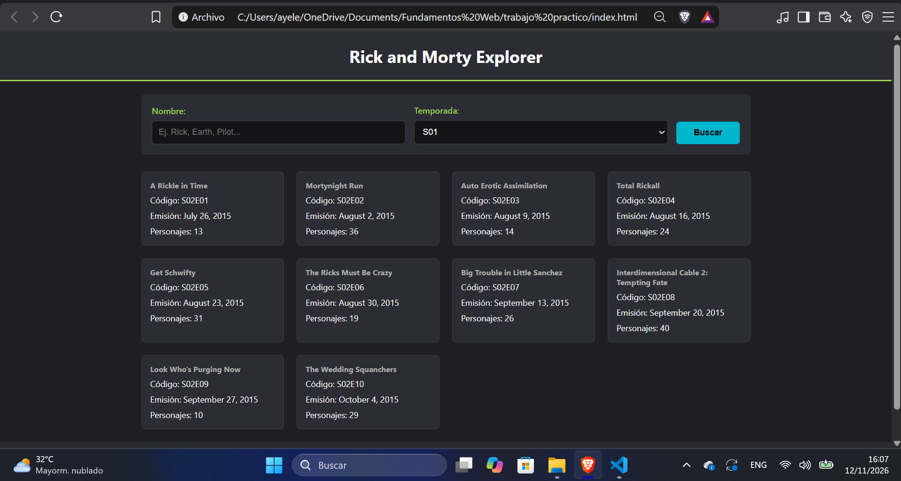

# Explorador de Episodios - Rick and Morty

Aplicación web desarrollada para la asignatura **Fundamentos de Desarrollo Web** (Ingeniería en Informática). Permite buscar y filtrar episodios de la serie *Rick and Morty* consumiendo su API REST pública.

## Datos del Estudiante
* **Nombre y Apellido:** Mariana Claverol
* **Variante asignada:** Variante C · Episodios (`https://rickandmortyapi.com/api/episode`)

## Funcionalidades implementadas
* Búsqueda combinada por nombre del episodio y filtro por temporada (`S01` a `S05`).
* Renderizado dinámico de tarjetas mediante manipulación segura del DOM (`createElement` y `textContent`).
* Gestión de estados de interfaz: indicador de carga, manejo de respuestas `404` como «sin resultados» y captura de errores de red.
* Persistencia automática de la última búsqueda realizada utilizando `localStorage`.
* Diseño adaptable (*responsive*) construido con CSS Grid, Flexbox y variables CSS.

## Vista previa
